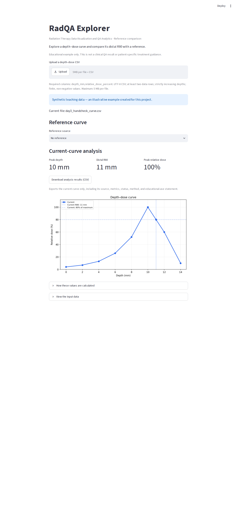
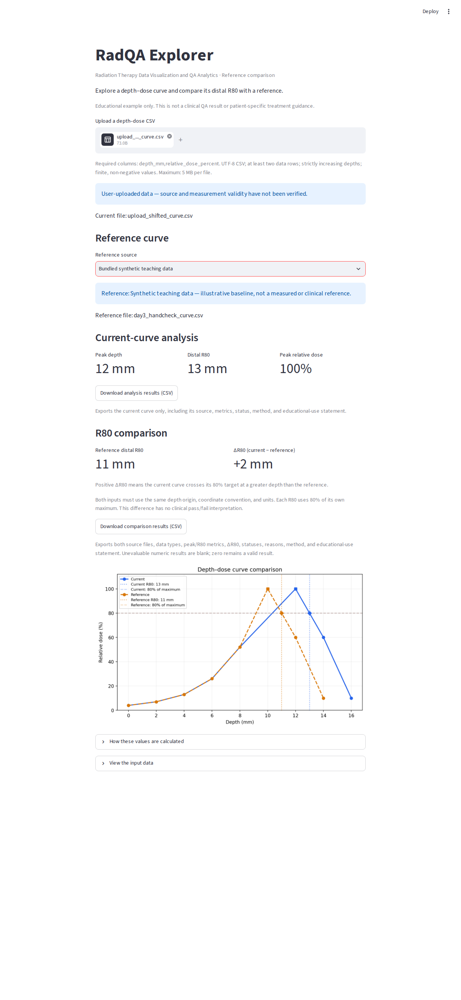

# RadQA Explorer

**Radiation Therapy Data Visualization and QA Analytics**

A Python and Streamlit educational prototype that turns depth–dose CSV files into inspectable curves, sampled peak metrics, distal R80 estimates, and reference-comparison reports.

**Educational demonstration only. All bundled datasets are synthetic teaching/test data. Outputs are not clinical QA results or patient-specific treatment guidance.**

## What it does

- Reads a default example or a user-uploaded CSV, with clear source labels.
- Rejects missing columns, nonnumeric values, duplicate depths, and unordered depths with specific explanations.
- Displays the depth–dose curve, first sampled peak, and distal R80.
- Overlays a bundled or uploaded reference and reports ΔR80 = current − reference.
- Exports source information, metrics, statuses, calculation method, and limitations as CSV.
- Reports **Not evaluable** when a distal crossing cannot be calculated; exported unavailable numeric fields stay blank.

## Screenshots

### Default synthetic example

Peak depth **10 mm**, distal R80 **11 mm**.



### Reference-comparison example

Current R80 **13 mm**, reference R80 **11 mm**, ΔR80 **+2 mm**.



Screenshots were captured from the running app in the assistant's Linux environment. They are demonstrations, not records of Windows execution.

## Run locally

Requires **Python 3.10+**. Extract or clone the project, then open a terminal in the folder containing `app.py`.

Windows:

```powershell
py -m pip install -r requirements_app.txt
py -m streamlit run app.py
```

macOS / Linux:

```bash
python3 -m pip install -r requirements_app.txt
python3 -m streamlit run app.py
```

Open the Local URL printed in the terminal, usually http://localhost:8501. Keep that terminal open. Stop with Ctrl+C. If prompted for an email, a blank response is sufficient. Windows users may alternatively use `01_install.bat`, `03_run_checks.bat`, and `02_start_app.bat`; see [the Chinese quick start](START_HERE_CN.md).

## Try a comparison

1. Upload `data/fixtures/upload_shifted_curve.csv` as the current input.
2. Select **Bundled synthetic teaching data** as the reference source.
3. Check current peak 12 mm, current R80 13 mm, reference R80 11 mm, and ΔR80 +2 mm.
4. Download the comparison CSV and check that it matches the page.
5. Replace the current file with `upload_no_crossing.csv`. The curve remains visible, while current R80 and ΔR80 become **Not evaluable**. Their exported numeric fields are blank, not zero.

## Input format

UTF-8 CSV (BOM accepted), up to 5 MB, with these exact column names:

```csv
depth_mm,relative_dose_percent
0,10
10,100
12,60
```

At least two rows are required. Depths must be strictly increasing. Depth and dose must be finite and non-negative. Input dose values are used as supplied; the app does not verify their normalization or measurement provenance. No patient data is needed for the examples.

Bundled files are constructed examples created for this project, not measurements or published beam datasets. The sparse curves test calculation behavior; they are not realistic beam models. Uploaded files are labeled **User-uploaded data**, with unverified source and measurement validity. The app reads uploads into memory and does not intentionally save them to disk.

## Calculation method

1. **Sampled peak:** the first sample attaining the maximum dose; no peak fitting.
2. **R80 target:** 80% of that curve's sampled maximum.
3. **Distal R80:** the first descending crossing after the selected peak, interpolated linearly between bracketing samples.

For adjacent samples `(x1, D1)` and `(x2, D2)` bracketing target `T`:

```text
R80 = x1 + (T - D1) * (x2 - x1) / (D2 - D1)
```

No crossing, or a nonpositive maximum, gives **Not evaluable**. There is no extrapolation. Tied maxima use the first sampled maximum; complex or multi-peaked curves require interpretation beyond this demonstration.

**ΔR80 = current R80 − reference R80.** A positive value indicates a greater crossing depth in the current curve. Both inputs must share depth origin, units, and coordinate convention. Each R80 uses its own maximum. No automatic normalization, alignment, resampling, or clinical pass/fail threshold is applied.

## Verification

```powershell
py -m unittest discover -s tests -v
py src/analyze_curve.py --self-check
```

The existing verification record contains **7 passing test methods**, **13 passing browser checks**, and **5 checked browser-downloaded comparison CSVs**. Method counts differ from parameterized scenario counts. See [the dated test record](verification/TEST_RECORD.md) and raw evidence in `verification/`.

These results were obtained in the assistant's Linux environment. Windows execution remains unconfirmed until recorded in [the Windows checklist](WINDOWS_CHECKLIST.md). See [the detailed guide](docs/DETAILED_GUIDE.md) for optional browser automation. Automated tests and synthetic examples do not establish clinical accuracy.

## Project structure

```text
app.py                     Streamlit interface
src/analyze_curve.py       CSV validation and curve metrics
src/comparison_export.py   Comparison records and CSV serialization
data/fixtures/             Synthetic valid and invalid examples
tests/                     Python tests and optional browser checks
verification/              Dated results, logs, and example exports
docs/                      Guides and actual app screenshots
```

## Current scope and next steps

This v0.4 prototype covers data ingestion, curve inspection, reference comparison, and traceable CSV reporting. A photon/proton educational visualization, energy slider, uncertainty estimation, longitudinal monitoring, and measured-data studies are future work and are **not implemented** in this version.

This package is ready for repository upload. It does not include a public GitHub repository or a hosted application URL.
